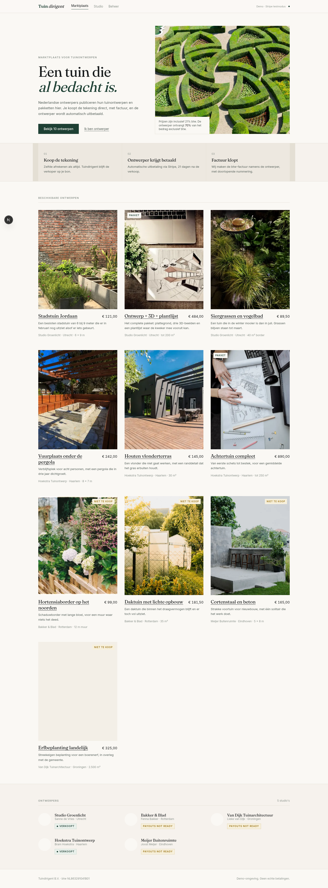
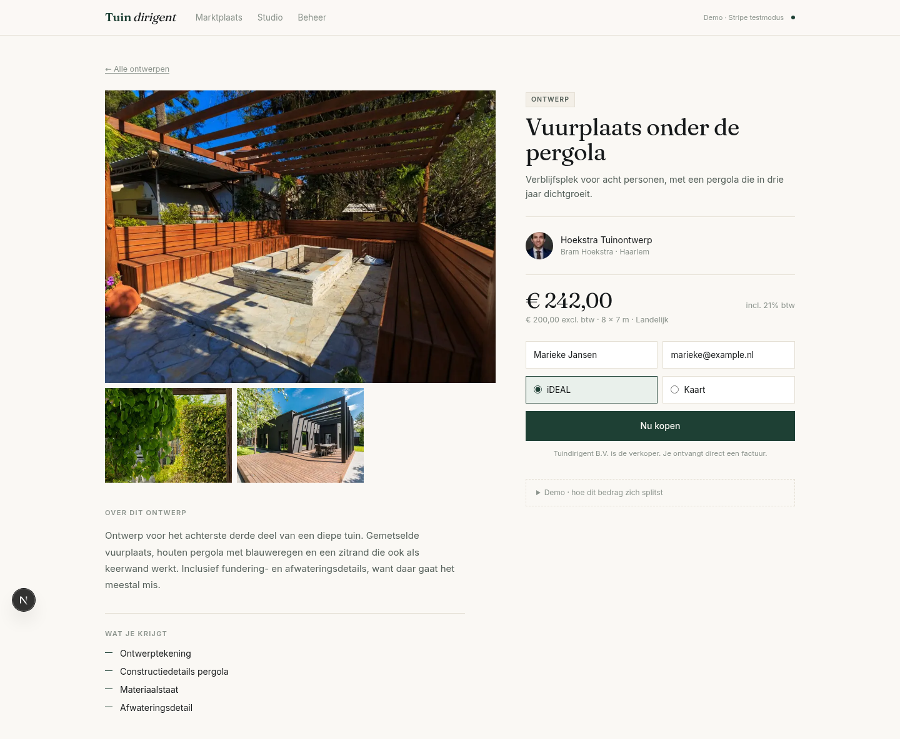
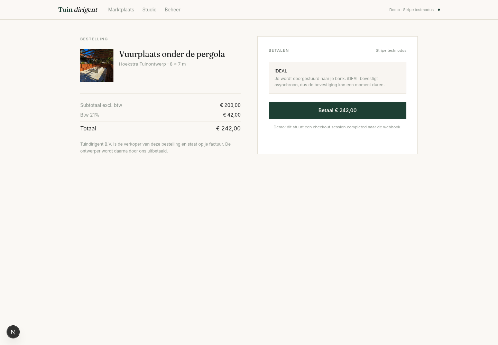
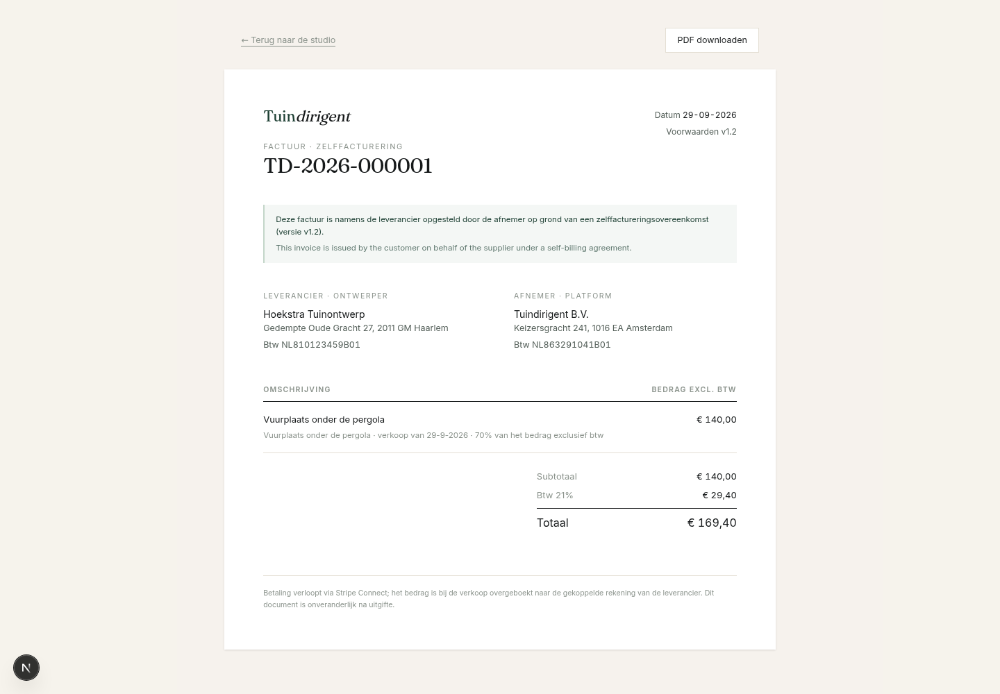
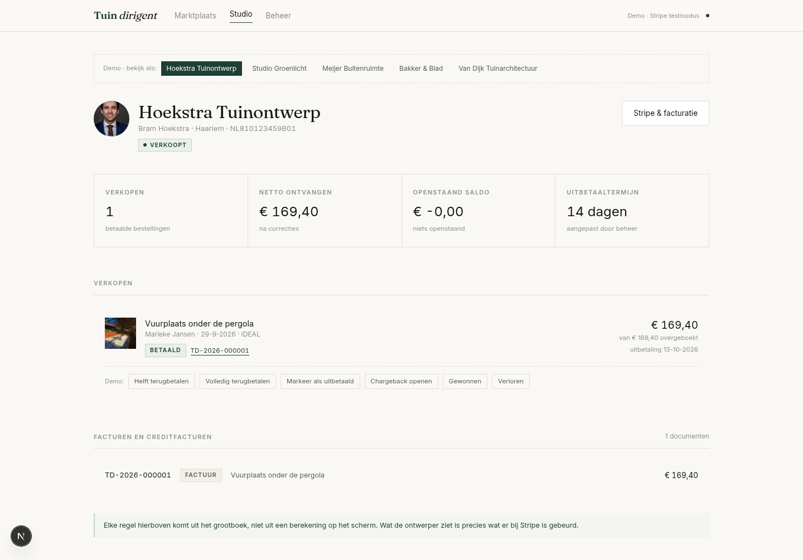
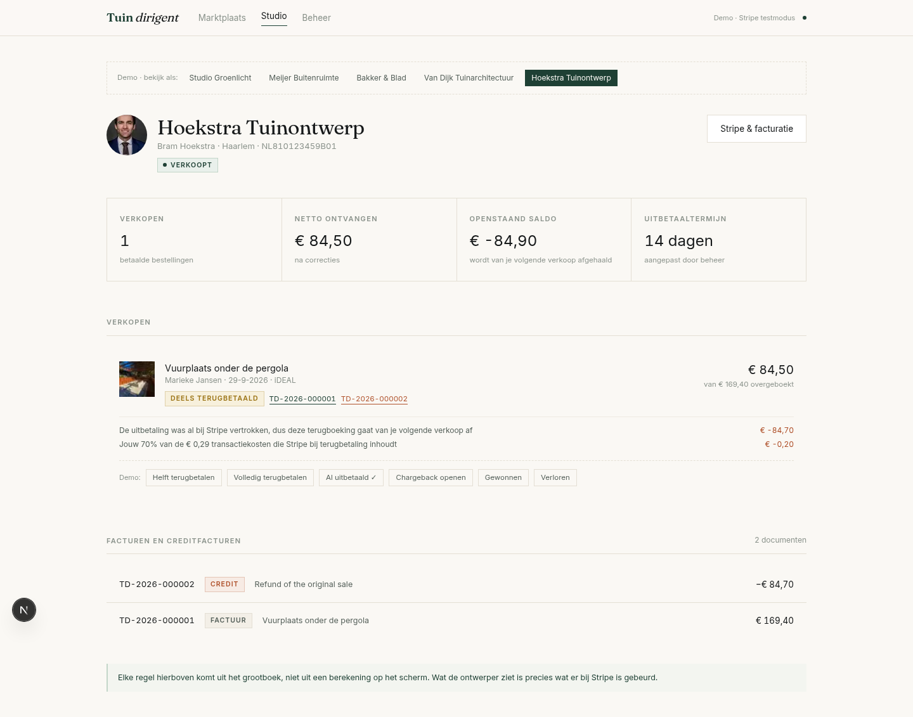
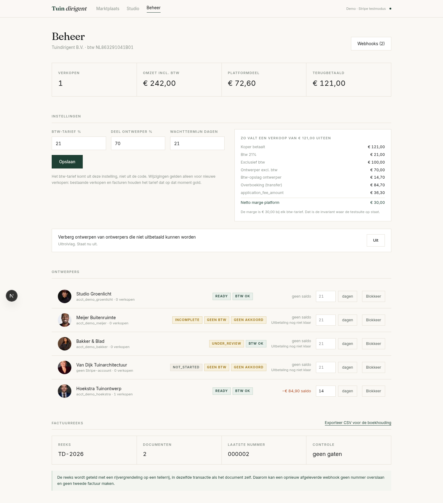
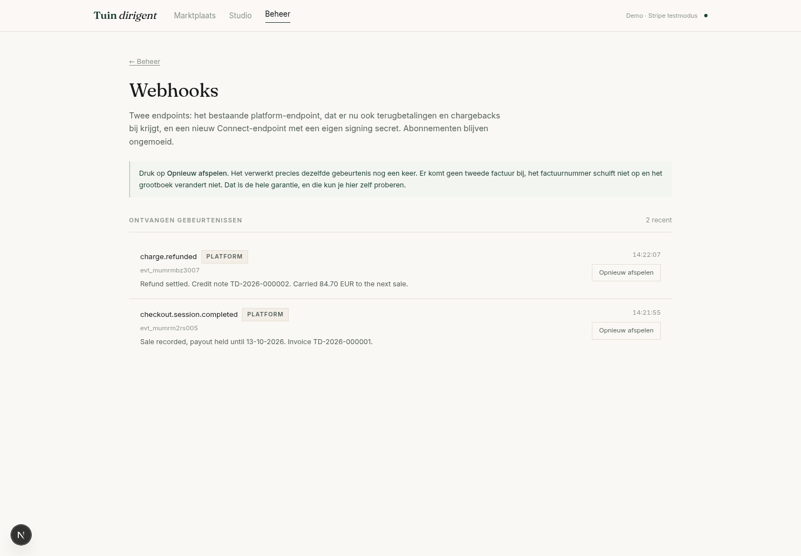
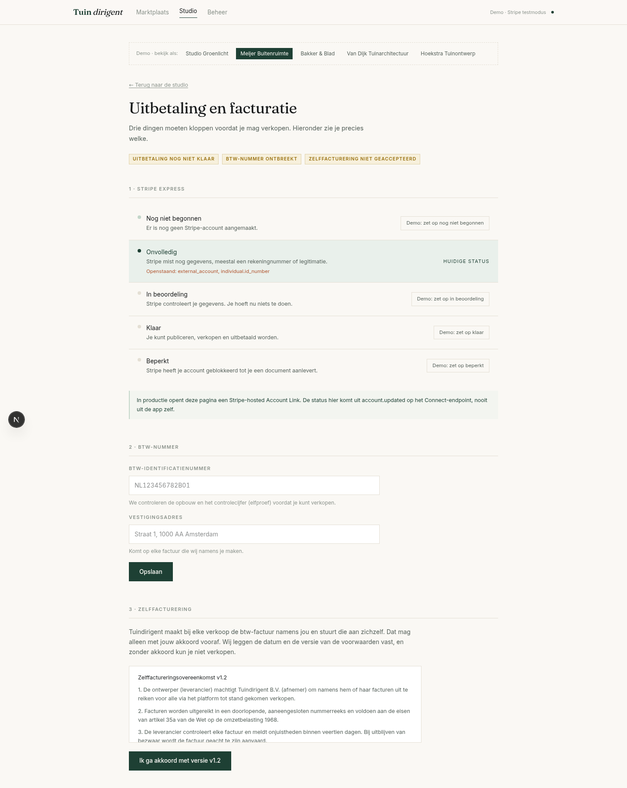

# Tuindirigent — Stripe Connect payout layer (MVP)

A working prototype of the payout arrangement described in the brief: designers
publish garden designs, buyers pay through the platform, and the designer's share
is transferred, held, reconciled on refunds and disputes, and invoiced back to the
platform under a Dutch self-billing agreement.

Every number on screen comes from one arithmetic module with a test suite behind
it, and every state change goes through a webhook handler that is safe to replay.

> **Unaffiliated prototype.** Built from a public job description as a working
> proposal. Not commissioned by, connected to, or endorsed by Tuindirigent. Every
> company detail in here — the VAT numbers, the addresses, the designers, the
> sales — is invented demo data, and no real payment is ever taken.

## Running it

```bash
docker run -d --name tuindirigent-db \
  -e POSTGRES_USER=tuin -e POSTGRES_PASSWORD=tuin -e POSTGRES_DB=tuindirigent \
  -p 5433:5432 postgres:16-alpine

pnpm install
pnpm exec prisma db push      # DATABASE_URL is in .env
pnpm exec tsx prisma/seed.ts
pnpm dev                      # http://localhost:3100
```

```bash
pnpm test      # 30 unit tests: payout, VAT, refund, credit note arithmetic
pnpm verify    # replays every webhook twice and proves nothing moved
```

No Stripe keys. The Stripe API is behind one adapter (`src/lib/stripe/mock.ts`)
that produces real-shaped objects and events; swapping it for the SDK is a change
in that file only.

## The walk-through

1. **Marktplaats** — ten designs from five designers. Two of them cannot be sold,
   and the reason is on the card.
2. **Ontwerp → Nu kopen** — the buyer's side is unchanged: same button, same price
   including BTW, platform stays merchant of record. Only the session carries a
   destination and an application fee now. A `Demo` panel underneath shows the split.
3. **Betaal** — fires `checkout.session.completed` into the webhook handler, which
   records the sale, starts the hold, and issues invoice `TD-2026-000001`.
4. **Studio** — the designer's view: what was transferred, what was deducted and
   why, when the payout lands, and every document.
5. **Markeer als uitbetaald → Helft terugbetalen** — forces the awkward case. The
   money has already left Stripe, the reversal fails, and the shortfall becomes a
   carried balance that the next sale will settle. A credit note is issued for
   exactly the proportion reversed.
6. **Beheer → Webhooks → Opnieuw afspelen** — replay any event, as often as you
   like. No second invoice, no skipped number, no extra ledger row.

## The money

A €121,00 sale at 21% BTW with a 70% designer share:

| | |
| --- | ---: |
| Buyer pays | €121,00 |
| BTW 21% | €21,00 |
| Ex-VAT | €100,00 |
| Designer share, ex-VAT | €70,00 |
| VAT gross-up on the designer's share | €14,70 |
| `transfer_data[destination]` | €84,70 |
| `application_fee_amount` | €36,30 |
| **Platform net margin** | **€30,00** |

The margin is €30,00 at any VAT rate, because the designer's VAT passes straight
through and is reclaimed. That is asserted as an algebraic identity in
`src/domain/money.test.ts`:

```
applicationFee − (outputVat − reclaimedVat) === net − designerNet
```

which reduces exactly, with no rounding drift, so it holds for every amount and
every rate. The suite checks it across four VAT rates and seven amounts, after
full refunds and after partial ones.

## How the hard parts are handled

**Gap-free invoice numbering under replayed webhooks.** A Postgres sequence is
not usable: `nextval()` is non-transactional, so a rolled-back insert leaves a
hole an accountant will ask about. Instead one counter row per series is locked
with `SELECT … FOR UPDATE` and incremented inside the same transaction as the
document insert, so the number and the document commit or roll back together.
Concurrent webhooks queue on the lock instead of racing. A unique index on an
idempotency key derived from the Stripe object is the backstop: if two callers
get past the read-through check, one transaction loses, releases its number, and
returns the document that won. `src/lib/services/invoicing.ts`.

**Refunds issued from the Stripe dashboard.** Nothing is triggered from the app.
The handler reacts to `charge.refunded`, reverses proportionally on the
VAT-inclusive amount that was transferred, shares the retained Stripe fee on the
same commission split, and issues the matching credit note. The credit note's own
existence is the idempotency marker for the whole refund.

**Reversal after the payout has already gone.** `Transfer Reversal` fails when the
connected account has no balance. The shortfall is written to the designer's
carried balance, shown to them with the reason, and taken off the next sale before
anything is transferred. `settleCarriedBalance` in `src/domain/money.ts`.

**Adding Connect without touching subscriptions.** Two endpoints: the existing
platform endpoint keeps its signing secret and only gains refund and dispute event
types; Connect events go to a new endpoint with its own secret. Enabling Connect
is additive and does not alter existing payment flows.

**Invoices that cannot change.** Everything an invoice needs — both parties'
details and VAT numbers, the rates, the amounts — is snapshotted on the purchase
at checkout. A later change to the designer's address or to the platform VAT rate
cannot reach an issued document.

## Layout

```
src/domain/          framework-free arithmetic — money, VAT, documents, messages
  money.ts           the split, reversals, cost sharing, carried balance
  vat.ts             Dutch BTW format and 11-proof check digit
  documents.ts       invoice and credit note amounts, numbering, idempotency keys
  *.test.ts          30 tests, including the platform-margin invariant
src/lib/stripe/      the Stripe adapter (mock; one file to swap)
src/lib/services/    checkout, webhooks, invoicing, publish gates
src/app/             Next.js routes — marktplaats, studio, beheer, factuur
prisma/schema.prisma the payout tables; subscriptions are deliberately untouched
scripts/verify-idempotency.ts
```

`src/domain` has no imports from Prisma, Stripe or Next. It moves into the
Express backend of the real monorepo unchanged.

## What is not built

Scoped out to keep this readable: real Stripe calls, VIES lookups, e-mail
delivery, authentication (the studio has a demo switcher instead), and the
production PDF pipeline — here the PDF renders on demand through headless Chrome
against the same HTML the browser shows, where production would render once on a
worker and store the result, since an issued document never changes.

## Screens

| | | |
| --- | --- | --- |
|  |  |  |
| Marktplaats | Ontwerp | Checkout |
|  |  |  |
| Zelffactuur | Studio | Na terugbetaling |
|  |  |  |
| Beheer | Webhooks met replay | Onboarding |

A rendered invoice is in [docs/TD-2026-000001.pdf](docs/TD-2026-000001.pdf).

Photography from the Pexels CDN under its free licence; in production these are
designer uploads behind signed URLs.
